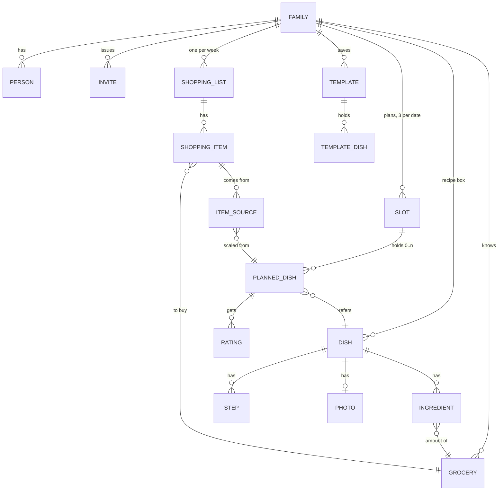

# Spec: family meal planner

Status: draft, chapter by chapter · started 2026-10-06 · owner: the author
Intent: [intent.md](intent.md) · Stack review: [approach-review.md](approach-review.md)

## How to read this spec

- Each requirement has an id (`SYNC-03`). Tests reference these ids so every requirement is traceable to an automated test.
- **MUST** is required for v1. **SHOULD** is wanted but can slip. **LATER** is recorded but not built in v1.
- Acceptance criteria are written as Given / When / Then so they can become automated UAT scenarios directly.
- This spec describes **behaviour**: what the family sees and what must always be true. How it's built (storage, ids, protocols) lives in [architecture.md](architecture.md), so the implementation can change without touching the spec.
- **All people in the examples are fictional:** the Rivera family (Carlos, Maria, Diego, Leo and Ava) and every address ending in `@example.com`. The same names are used in the milestones, tests and seed data.

## Decisions log

| Date | Decision |
|---|---|
| 2026-10-05 | No kid PINs. Every family member has their own account with email and password. |
| 2026-10-06 | Stack: .NET ~~10~~ 11 (moved 2026-11-10) Blazor WebAssembly PWA, ASP.NET Core API, PostgreSQL, EF Core (server only), Vertical Slice Architecture, OpenTelemetry + ~~Serilog~~ (dropped 2026-11-10), Aspire for local development, Docker Compose on a cheap VM (OVH, no provider lock-in). |
| 2026-10-06 | Sign-up is **invite only**. There is no public "create a family" sign-up. |
| 2026-10-06 | Offline **edits are shopping only** in v1: ticking and unticking items and adding or removing extra items. Everything else is readable offline, but planning and recipe edits need a connection. No conflict screen in v1. |
| 2026-10-06 | **No pantry.** Every ingredient lands on the shopping list, and staples the family already has are ticked off by hand. The Pantry screen and "We always have this" in the designs are dropped. |
| 2026-10-06 | **Week start day is a family setting** (any day, Monday by default). Plans are stored by date, so changing it never moves anything. |
| 2026-10-08 | **The shopping list is live.** Unticked lines follow the plan; ticked lines never change; if more is needed after something was ticked, the shortfall appears as a new unticked line (DOM-19 to DOM-22). |
| 2026-10-08 | **Extras merge only with an amount.** A hand-typed extra joins the unticked line for the same grocery only when it has an amount in a unit that combines; otherwise it stays its own line (DOM-23). |
| 2026-10-08 | **A family is created only by a server command** (for example `mealplanner create-family "Rivera" carlos@…`), which emails an owner invite. There is no web page for it. The same command can seed a demo family. |
| 2026-10-08 | **Dates use the family's time zone**, set at creation and changeable by anyone in the family. Moments in time (ticks, saves) are stored in UTC and shown in local time. |
| 2026-10-08 | **Renaming a grocery onto an existing name merges them**, after a confirm (DOM-25). |
| 2026-10-08 | **Rating opens on the slot's date**, with no need to mark the dish as cooked first (DOM-26). |
| 2026-10-08 | **No roles besides the owner.** Everyone in a family can do everything, except that only the owner can invite, remove people, hand the family over or delete it (and, since 2026-10-12, change the week start day). The designs' "Who can do what" screen and the Member/Helper role are dropped. |
| 2026-10-08 | **No family code.** An email invite to a specific address is the only way to join a family. |
| 2026-10-12 | **Only the owner can change the week start day** (DOM-18, ACC-02). |
| 2026-10-12 | **Adding a dish that's already on the list says so** ("Taco night was already on the list, so nothing was added for it") instead of silently skipping it (DOM-06, PLAN-23). |
| 2026-10-12 | **Notifications and install:** settings are per person; a new person has only the planning reminder on (evening before the week starts); quiet hours 21:00 to 07:00 for everyone; the install card appears right after first sign-in (NOTE-01, NOTE-09, INST-02). |
| 2026-10-14 | ~~**The code repository is private** (the author). Security rules stay as strict as for a public repo; gitleaks in CI replaces GitHub secret scanning.~~ Replaced on 2026-11-10: the repository is public (below). |
| 2026-10-13 | **No step timers in v1.** Cook mode has no timers; steps are text only, and "Bake for 20 minutes" is just part of the text. Timers are LATER (6.3). |
| 2026-10-12 | **Cook mode and rating:** ~~timers keep running when you move to another step~~ (timers moved to LATER on 2026-10-13); the Week tab asks about unrated meals from the last 2 days; rating has no end date (COOK-11, RATE-02, RATE-04). |
| 2026-10-12 | **One unit kind per grocery.** Units are always picked from a dropdown that offers only the grocery's kind (weight, volume, or one count unit), set by its first use, so amounts of a grocery always combine (DOM-08). Shopping: the tab opens on the earliest list with something to buy; dish lines are removed with "We have it"; Add item has separate name, amount and unit fields (SHOP-01, SHOP-16, SHOP-23). |
| 2026-10-08 | **Week planning:** a dish added to a slot starts at the family's size in servings; the Week tab has a day list view next to the grid; planning reaches 4 weeks ahead (PLAN-02, PLAN-04, PLAN-11). |
| 2026-10-06 | UI in **English**, **metric units** (g, kg, ml, l, pcs, tsp, tbsp). The designs' cups, lb and oz become metric. |
| 2026-11-10 | **Logging through .NET's `ILogger` with the OpenTelemetry exporter; no Serilog.** Aspire's ServiceDefaults already send logs, traces and metrics over one OTLP pipeline with matching trace ids, and Seq accepts OTLP, so Serilog would only add a second pipeline to keep in step. |
| 2026-11-10 | **.NET 11 and C# 15 instead of .NET 10.** .NET 11 went GA on 2026-11-10. As an STS release it's supported until November 2028, the same month as .NET 10 LTS, so nothing is lost on support; the move to .NET 12 LTS (November 2027) is planned as a normal upgrade. EF Core stays on 10.x until EFCore.NamingConventions ships an 11.x build (architecture §2). |
| 2026-11-10 | **The code repository is public** (the author), replacing the 2026-10-14 decision. Every push first passes a pre-push review: fixed checks (no secrets, no personal data, only the GitHub noreply email, build and tests) and a review by an AI agent against a checklist. CI repeats the fixed checks, rulesets require a PR and green CI on `main`, and the author merges. A public repo also gets free CI minutes and GitHub's secret scanning and push protection. |
| 2026-11-10 | **Deleting a dish** removes it from slots from **tomorrow** on, so today's meals and their ratings stay. A deleted dish keeps only its name and ratings; its ingredients, steps and photo are deleted. A dish that was never planned is deleted completely (DOM-04, REC-32, REC-33). |
| 2026-11-10 | **The live list only changes current lists.** Plan and recipe changes update only shopping lists whose last day is today or later; older lists stay as they were shopped (DOM-19). |
| 2026-11-10 | **Ticks and extras always go through the outbox**, online or offline; online it's simply sent at once. One set of rules for every tick (SYNC-15), and no "someone changed this" message over a tick. |
| 2026-11-10 | **Account actions need a connection; family data opens offline.** Signing in, invites, passwords and profile changes say "You're offline. This needs a connection" offline (SYNC-03). The Family tab's people list opens offline from M2a on (SYNC-01). |
| 2026-11-10 | **Before v1, only the outbox format is kept stable.** Until the v1 release, waiting ticks and extras from any earlier version are always accepted, but other changes may ask an old phone to update (UPD-05). The full 30-day rule for every request (UPD-04) starts with v1. |
| 2026-11-10 | **Shopping sync details settled** (1.9, questions 4 to 7): a tick records the amount seen; removing an already-bought extra is dropped with a reason; ties go to the later operation id; phones correct their clock by the server's. An extra whose unit doesn't fit its grocery is kept without its amount (X14). |
| 2026-11-10 | **The 15-minute lockout stays** (ACC-31). Someone could lock another person out on purpose, but a phone that's already signed in keeps working, so the risk is small, and the lockout built into ASP.NET Identity needs no custom code. |

## Chapters

0. Glossary and domain model ← draft, reviewed 2026-10-08
1. Offline and sync ← draft, revised for shopping-only offline edits
2. Accounts, invites and the owner ← draft
3. Recipe box ← draft
4. Week planning ← draft, settled
5. Shopping list ← draft, settled
6. Cook mode and rating ← draft, settled
7. Notifications, install prompt and app updates ← draft, settled
8. Non-functional: performance, security, accessibility, observability, backups ← started (8.1 input safety)

---

## 0. Glossary and domain model

### 0.1 Glossary

One word per idea, used the same way in the UI, the spec, the code and the tests.

| Term | Meaning | Not to be confused with |
|---|---|---|
| **Family** | The group that shares one recipe box, one plan and one shopping list. | |
| **Person** | Anyone in a family. Each person has their own account (email and password). | "Owner". |
| **Owner** | The one person who looks after the family's membership and its week: only the owner can invite, remove people, hand the family over, delete it, or change the week start day. Everyone else can do everything else. | |
| **Invite** | An email invitation that lets one named email address join this family. The only way in: there is no family code. | |
| **Dish** | One thing the family eats, in the recipe box, like "Sandwiches" or "Scones". Can be just a name. | "Slot". The word "meal" isn't used in the spec or code because it can mean either. |
| **Recipe** | A dish's ingredients and steps. | |
| **Grocery** | One thing you can buy, like "Butter": a name, its aisle and its **unit kind** (weighed, measured by volume, or counted in one unit such as pcs). A family has **one** Butter, shared by every recipe and the shopping list. | "Ingredient". |
| **Ingredient** | One line of a recipe: an amount and unit of a grocery ("50 g Butter, softened"). | "Grocery". |
| **Recipe box** | All of a family's dishes. | |
| **Week** | 7 days starting on the family's **week start day** (any day, Monday by default; Tuesday gives Tuesday to Monday). A week is a *view* over days, not something stored. | |
| **Week start day** | A family setting only the owner can change. | |
| **Family time zone** | The time zone that decides what "today" and every date mean for the family, on every phone and on the server. | The phone's own time zone. |
| **Slot** | One date's breakfast, lunch or dinner: 3 per day, 21 per week. Holds **any number of dishes** (Monday breakfast: Sandwiches and Scones), or is marked **skipped** (eating out). | "Dish". |
| **Planned dish** | A dish put into a slot, with its own number of servings. | |
| **Template** | A saved week (or its breakfasts, lunches or dinners) to start a new week from. Stored by weekday (Monday, Tuesday…), so it fits whatever day the week starts on. | |
| **Shopping list** | The list for one week, covering the 7 dates it was created for. Items are added from planned dishes (🛒) or typed in. | |
| **Shopping item** | One line on the list: a grocery, amount, unit, ticked or not. | |
| **Extra item** | A shopping item typed in by hand rather than coming from a dish. | |
| **Aisle** | Where it is in the shop: Produce, Meat & fish, Dairy & eggs, Bakery, Pantry (the shop's dry-goods aisle), Frozen, Other. | |
| **Rating** | A person's verdict on a planned dish after cooking it. | |

### 0.2 Entities

Every entity belongs to exactly one family, except the account itself. **Lists are never a single field**: every ingredient, step, planned dish and shopping item is its own record with its own id and position, so two people adding to the same list never overwrite each other.


<details>
<summary>Diagram source (Mermaid; renders on GitHub and in VS Code with a Mermaid preview extension; regenerate domain-model.png when it changes)</summary>



</details>

| Entity | Key fields |
|---|---|
| Family | name, owner, time zone (for example Europe/Warsaw), week start day (default Monday) |
| Person | account (email, verified, password), family, display name, sticker colour, foods they don't eat |
| Invite | email, invited by (the owner), expires, used or cancelled |
| Dish | name, description, course (main, side, dessert), suits (breakfast, lunch, dinner), total minutes, serves, tags (veggie, kid fave), photo, added by |
| Grocery | family, name (unique in the family), aisle, unit kind (weight, volume, or one count unit), set by the first unit chosen for it |
| Ingredient | dish, position, grocery, amount (optional), unit (optional), note (optional, like "softened") |
| Step | dish, position, text |
| Slot | family, date, breakfast / lunch / dinner, skipped |
| Planned dish | slot, dish, servings, position (order within the slot) |
| Shopping list | family, first date, last date (7 days) |
| Shopping item | list, grocery, amount, unit, ticked, ticked by and when, extra or not |
| Item source | shopping item, then either a planned dish and ingredient, or an extra (who added it); amount and unit |
| Template | name, which slots it includes (breakfasts, lunches, dinners) |
| Template dish | template, weekday, breakfast / lunch / dinner, dish, servings |
| Rating | planned dish, person (one per person per planned dish), verdict (loved it, OK, not again), when |

### 0.3 Rules that are always true

| ID | Rule |
|---|---|
| DOM-01 | A person belongs to exactly one family at a time. |
| DOM-02 | A family has exactly one owner. Everyone else in the family has the same rights, and the owner has those plus the owner-only actions (ACC-02). |
| DOM-03 | A family has at most one slot per date and breakfast, lunch or dinner. Plans are stored by **date**, so changing the week start day never moves, loses or duplicates a planned dish; the week view simply starts on a different day. |
| DOM-04 | A planned dish always refers to a dish in the same family's recipe box. Deleting a dish removes it from every slot from tomorrow on, after a warning (the designs' "It's on Thursday's dinner"); today's and past slots keep its name (REC-32, REC-33). |
| DOM-05 | A shopping item made from dishes keeps a source for each planned dish and ingredient it came from, so "for Taco night, Dad's big chili" and the "by recipe" view are always right. |
| DOM-06 | Adding the same planned dish to the list twice doesn't double its ingredients, and the person is **told** that nothing was added for it (PLAN-23). The same dish planned on two different slots is two planned dishes, so its ingredients are needed twice and do add up. |
| DOM-07 | There is no pantry. Every ingredient of a dish added to the list lands on it, staples like salt included; things the family already has are ticked off by hand. |
| DOM-08 | Amounts are metric. **Each grocery has one unit kind**: weight (g, kg), volume (ml, l, tsp, tbsp) or a single count unit (pcs, clove, slice, can, pack or bunch). It is set by the first unit chosen for that grocery. Every amount of it, in recipes and on the list, is picked from a unit dropdown that offers only that kind, so all amounts of one grocery always combine (g with kg, tsp with ml). Combined weights and volumes show in kg or l from 1,000 g or ml upwards ("1.5 kg"), and tsp and tbsp show as ml once they are mixed with ml or l. (the author, 2026-10-12.) |
| DOM-09 | A skipped slot counts as done in the week's progress (x of 21). |
| DOM-10 | Nothing one family owns can ever be read or changed by a person in another family. |
| DOM-11 | A slot can hold any number of dishes, each with its own servings, in an order the family chooses. The same dish can't be in one slot twice; change its servings instead. (Confirmed by the author 2026-10-08.) A slot with at least one dish, or marked skipped, counts as planned. |
| DOM-12 | A family has **one grocery per name**, ignoring case and extra spaces ("butter", "Butter " and "BUTTER" are the same). Typing a name when adding an ingredient or an extra item suggests the existing grocery. A new name creates a new grocery. |
| DOM-13 | If two people create the same new grocery at the same moment, both end up using the same one. |
| DOM-14 | A grocery's aisle and name live in one place. Changing them (for example moving Butter to "Dairy & eggs") changes them in every recipe and list. |
| DOM-15 | Unticked shopping items for the same grocery combine into one line (following DOM-08 for units), whichever recipes they came from. A ticked line and any top-up for it (DOM-20) stay separate lines. |
| DOM-16 | An extra item typed in offline is matched to a grocery by name when it syncs, or creates one. |
| DOM-17 | Shopping lists never overlap. When the week start day changes, existing lists keep their dates. The first list after the change covers the days from the end of the last list to the day before the new start day (possibly fewer than 7), then normal 7-day weeks follow. |
| DOM-18 | Only the owner can change the week start day (the author, 2026-10-12). It applies to everyone in the family, so all phones show the same week. Everyone else sees it in Family settings but can't change it. |
| DOM-19 | **The list is live for unticked lines.** When a planned dish on the list is removed, its servings change, or its recipe's ingredients change, every *unticked* line it contributed to is updated to match, on lists whose last day is today or later. Older lists stay exactly as they were shopped. A line left with nothing to buy disappears. Extra items are never touched by plan changes. |
| DOM-20 | **Ticked lines never change.** A tick means "bought this amount". If the plan later needs more of that grocery, the shortfall appears as a new unticked line, such as "+100 g Butter, for Apple crumble". |
| DOM-21 | If the plan later needs *less* of a ticked grocery (a dish was removed), the ticked line stays as it was, because it has already been bought. |
| DOM-22 | A tick applies to the amount the person saw when ticking. If the line grew before the tick reached the server (for example, ticked offline while someone added a dish), the tick covers the amount seen, and the difference becomes a new unticked line. |
| DOM-23 | **An extra item with an amount merges** into the *unticked* line for the same grocery, whether that line came from a recipe or from earlier extras. Amounts always combine because a grocery has one unit kind (DOM-08): 500 g and then 1 kg of Minced beef make one line, "1.5 kg Minced beef". The extra is listed as a source ("for Apple crumble, + 200 g from Maria"). An extra with no amount, or for a grocery whose only line is ticked, stays its own line. Removing a merged extra takes away just its amount, and plan changes never remove it (DOM-19). |
| DOM-24 | **Dates are in the family's time zone.** "Today", which day the Week tab opens on, the 8-week window (SYNC-04) and reminder times all use it, on every phone and on the server, whatever time zone the phone is in. Moments in time (when something was ticked or saved) are stored in UTC and shown in the phone's local time. Anyone in the family can change the family time zone; changing it never moves a planned dish (plans are stored by date, DOM-03). |
| DOM-25 | **Renaming a grocery to a name that already exists offers a merge** ("Butter already exists. Merge them?"). Merging keeps the existing grocery (its name, aisle and usual unit), moves every recipe ingredient and shopping line to it, combines unticked list lines (DOM-15) and leaves ticked lines as they are (DOM-20). Two groceries of different unit kinds can't be merged ("Onion is counted in pcs, Red onion is weighed. Change one of them first."). Cancelling leaves both groceries unchanged. Anyone allowed to edit dishes can merge. It needs a connection (SYNC-03). |
| DOM-26 | **A planned dish can be rated from its slot's date onwards** (in the family time zone, DOM-24). It does not have to be marked as cooked first. Dishes in a skipped slot, and dishes on future dates, can't be rated. |
| DOM-27 | **A grocery's unit kind can be changed** from the item editor or an ingredient line only while no recipe and no unticked list line uses it with an amount. Otherwise it shows where it is used ("Onion is in pcs in 3 recipes") so those can be edited first. |

```gherkin
Scenario: Butter is one grocery across recipes
  Given the recipe box has no grocery called "Butter"
  When Maria adds "50 g Butter" to "Garlic bread"
  And a few minutes later Diego adds "butter" to "Apple crumble"
  Then Diego is offered the existing "Butter" while typing
  And the family has exactly one grocery "Butter"
  And when both dishes are added to the shopping list, there is one "Butter" line

Scenario: Two people create the same grocery at once
  Given the family has no grocery called "Sour cream"
  When Maria and Diego each add "Sour cream" to a different dish at the same moment
  Then the family has exactly one grocery "Sour cream", used by both dishes

Scenario: More butter needed after it was bought
  Given "Garlic bread" is on the list and Maria has ticked "50 g Butter"
  When Diego adds "Apple crumble", which needs 100 g Butter, to the list
  Then "50 g Butter" stays ticked
  And a new unticked line "+100 g Butter, for Apple crumble" appears

Scenario: A dish leaves the plan
  Given "Taco night" and "Dad's big chili" are on the list, with "900 g Minced beef" unticked
  When Diego removes "Taco night" from Tuesday dinner
  Then the line becomes the amount "Dad's big chili" needs
  And lines only "Taco night" needed disappear, unless they were ticked

Scenario: Ticked offline while the line grew
  Given Maria is offline and sees "50 g Butter"
  And meanwhile Diego adds "Apple crumble" so the line becomes "150 g Butter"
  When Maria ticks "50 g Butter" and comes back online
  Then "50 g Butter" is ticked
  And "+100 g Butter, for Apple crumble" is unticked

Scenario: An extra with an amount joins the recipe line
  Given the list has unticked "150 g Butter, for Apple crumble"
  When Maria adds the extra "200 g Butter"
  Then there is one line "350 g Butter" showing "for Apple crumble, + 200 g from Maria"

Scenario: Extras in g and kg make one line
  Given the list has no "Minced beef"
  When Maria adds the extra "500 g Minced beef"
  And later Diego adds the extra "1 kg Minced beef"
  Then there is one unticked line "1.5 kg Minced beef" showing "+ 500 g from Maria, + 1 kg from Diego"

Scenario: An extra without an amount stays separate
  Given the list has unticked "150 g Butter, for Apple crumble"
  When Maria adds the extra "Butter" with no amount
  Then "Butter, added by Maria" is its own line next to "150 g Butter"

Scenario: Renaming a grocery onto an existing one merges them
  Given the family has groceries "Butter" and "Unsalted butter"
  And "Apple crumble" uses "Unsalted butter"
  When Diego renames "Unsalted butter" to "Butter" and accepts the merge
  Then the family has one grocery "Butter"
  And "Apple crumble" uses "Butter"

Scenario: Week starts on Tuesday
  Given Maria is the family's owner
  And the family's week starts on Monday
  And "Taco night" is planned for dinner on Tuesday 13 October
  When Maria changes the week start day to Tuesday
  Then the Week tab shows Tuesday 13 October to Monday 19 October
  And "Taco night" is still on dinner on Tuesday 13 October
  And Diego's phone shows the same week after it syncs

Scenario: Only the owner changes the week start day
  Given Diego is in the family and is not the owner
  When Diego opens Family settings
  Then he sees "Week starts on Monday" but can't change it
  And a change sent directly to the server is refused
```

### 0.3b Limits

Confirmed as written by the author, 2026-10-08. Limits do two jobs. **Product limits** keep the 360 px screens readable and stop typos like 100 servings. **Safety limits** stop one account (or a stolen password) from filling the server, since the app is on the public internet. Every limit is enforced by the server and shown in the UI: the + button disables at the maximum with a short hint, never an error after saving.

| ID | What | Limit | Why |
|---|---|---|---|
| LIM-01 | Servings a recipe is written for | 1–12 | Matches the Add a dish design. |
| LIM-02 | Servings of a planned dish | 1–20 | Room for a birthday or a family visit. The recipe view's scaler uses the same range. |
| LIM-03 | Dishes in one slot | 8 | Enough for a big breakfast. The week grid shows two names and "+N more". |
| LIM-04 | Ingredients per dish | 40 | |
| LIM-05 | Steps per dish | 30, each up to 1,000 characters | |
| LIM-06 | ~~Step timer~~ | none in v1 | Step timers are LATER (6.3, the author 2026-10-13). |
| LIM-07 | Total time of a dish | 5–600 minutes, in steps of 5 | Slow cooking goes past the design's 300. |
| LIM-08 | Names (dish, grocery, template, family, person) | 1–80 characters | |
| LIM-09 | Amount | greater than 0, up to 10,000, at most 2 decimals | |
| LIM-10 | Lines on one shopping list | 300 | |
| LIM-11 | People in a family | 12 | |
| LIM-12 | Open invites at once | 10, each valid for 7 days | |
| LIM-13 | Dishes in the recipe box | 2,000 | Safety limit. |
| LIM-14 | Groceries | 3,000 | Safety limit. |
| LIM-15 | Templates | 30 | |
| LIM-16 | Dish photo upload | up to 10 MB, JPEG, PNG, WebP or HEIC, stored resized | Safety limit and storage on the VM. |
| LIM-17 | Other free text | dish description 500 characters; ingredient note 100; "Food I don't eat" 200; email address 254 | Safety limit (SEC-01). |

### 0.4 Not in the model yet (later chapters decide)

- ~~Notification settings (chapter 7).~~ Per person, in chapter 7 (NOTE-01).

### 0.4b Captured for later chapters

Requests and details agreed in conversation, to be written up properly in their chapter.

- **Chapter 5, shopping list:** extra items are typed in by hand, online or offline (SYNC-02); they go in "Other" unless an aisle is picked.
- **Chapter 5, shopping list:** a single **Clear list** button (it's in the Week Plan design). It asks "Clear the whole list?" first, offers Undo for a few seconds, and needs a connection, because it removes everyone's items at once. It removes **everything**: ticked and unticked, from dishes and extras (the author, 2026-10-06).
- **Chapter 2, accounts:** written up in chapter 2 (ACC-10, ACC-11).
- **Chapter 8, non-functional (raised 2026-10-13 by the delivery-milestones work):** speed targets for the Galaxy A5 and a photo storage budget (SYNC-04), so CI has numbers to enforce; requirement ids for deploys and backups (milestone M4a); the terms text people agree to on joining (ACC-22, milestone M1a); the format of the data download (ACC-43).
- **Chapter 6, rating (agreed with the author, 2026-10-06):** everyone in the family can rate, so rating isn't behind a permission. Each person gives one rating per planned dish (each time it's served) and can change it; the newest replaces the old. Answers: **Loved it / OK / Not again**. The recipe box ♥ counts the people whose latest rating of that dish is "Loved it". Planning shows hints like "Leo: Not again". Rating is offered at the end of cook mode and on the slot afterwards. Rating opens on the slot's date and doesn't need "cooked" to be marked first (DOM-26, 2026-10-08).

### 0.5 Open questions

1. ~~**"Member" is both a word for anyone and the name of a role.**~~ Resolved 2026-10-08: there are no roles besides the owner, so the clash is gone.
2. ~~**One family per person**~~ Confirmed by the author 2026-10-08: one family per person (DOM-01).
3. ~~**Duplicate groceries with different names**~~ Resolved 2026-10-08: rename one to the other's name and accept the merge (DOM-25).

---

## 1. Offline and sync

### 1.1 Goal

Every screen opens and shows the family's data with no connection. In the shop with no signal, the shopping list can be ticked off and added to, and those changes reach the family once there's a connection. Planning and recipe edits need a connection in v1, and the app says so instead of failing.

### 1.2 What works offline

| ID | Requirement |
|---|---|
| SYNC-01 | MUST: every screen opens offline, showing the family's data as of the last sync. This includes cook mode. |
| SYNC-02 | MUST: offline, a person can tick and untick shopping items, add extra items and remove extra items. |
| SYNC-03 | MUST: offline, everything else that changes data (planning, dishes, templates, family settings, ratings) is visibly unavailable. Tapping it says "You're offline. This needs a connection." Nothing is half-saved. |
| SYNC-04 | MUST: the device keeps all of the family's dishes, every planned date from 8 weeks ago onwards, all their shopping lists, and dish thumbnails. Full-size photos are kept once viewed, up to a storage budget (chapter 8). |

### 1.3 Offline shopping changes

| ID | Requirement |
|---|---|
| SYNC-10 | MUST: an offline shopping change shows immediately, with no wait. |
| SYNC-11 | MUST: a change made offline survives closing the app, restarting the phone and an app update. |
| SYNC-12 | MUST: an item with a change not yet sent shows the amber "waiting" dot until the family has it. |
| SYNC-13 | MUST: waiting changes are sent automatically when the app opens, when the connection comes back, and on pull-to-refresh. Where the browser allows it (Android), they are also sent after the app is closed. |
| SYNC-14 | MUST: sending the same change twice, for example after a lost response, has no extra effect. |
| SYNC-15 | MUST: if two people tick or untick the same item, the **most recently made** change wins, by the time it was made, not the time it arrived. So Diego's 10:30 untick at home beats Maria's 10:00 tick made in the basement and synced at 11:00. |
| SYNC-16 | MUST: extra items added by different people are all kept, even with the same name. Whether an extra shows as its own line or inside a recipe line follows DOM-23; on an offline phone it shows as its own line until it syncs. |
| SYNC-17 | MUST: if the item was removed while the phone was offline (someone took the dish off the list), the offline tick is dropped quietly. |

**Worked examples.** How SYNC-15 to SYNC-17, DOM-22 and DOM-23 combine, written as cases with one expected result each. Each becomes a test in the milestone named. Times are when the change was made on the phone. Ticks and extras are sent the same way online and offline ([sync contract §5](sync-contract.md#5-ticks-and-extras)), so "online" below only means "sent at once".

| # | Situation | Result | Proven in |
|---|---|---|---|
| X1 | Maria ticks "Milk" offline at 10:00 (sent at 11:00); Diego unticks it online at 10:30 | Unticked: 10:30 is the latest change (SYNC-15) | M3a |
| X2 | Maria ticks "Milk" offline at 10:00; Diego ticks it online at 10:30 | Ticked once; nothing is doubled | M3a |
| X3 | Maria sees "500 g Minced beef" offline and ticks it at 10:00; at 10:15 Carlos adds a dish needing 300 g more | One ticked line "500 g Minced beef" and a new unticked line "300 g Minced beef" (DOM-22). Works because an unticked line keeps its id when it changes (architecture §3) | M7 |
| X4 | Maria ticks "Sour cream" offline; meanwhile Carlos takes the only dish needing it off the list | The tick is dropped quietly (SYNC-17) | M7 |
| X5 | Maria and Diego, both offline, each add "Milk 1 l"; there's no Milk line yet | Each phone shows its own line until it syncs; after both sync, one unticked line "2 l Milk" listing both people (SYNC-16, DOM-23) | M3a |
| X6 | Maria and Diego, both offline, each add "Bread" with no amount | Two separate "Bread" lines (DOM-23) | M3a |
| X7 | "150 g Butter, for Apple crumble" plus Maria's extra 200 g shows as "350 g Butter"; Maria removes her extra | "150 g Butter, for Apple crumble" (DOM-23) | M7 |
| X8 | Diego's phone clock is 2 hours fast. At a real 10:30 he ticks "Eggs" offline and stays offline until 11:30; Maria unticks at 11:00 | Diego's phone knows from its last server response that it's 2 hours fast, so it stamps 10:30, and Maria's 11:00 untick wins (1.9, question 7). A time still in the future when it arrives is clamped to the server's time | M3a |
| X9 | Maria's phone clock is 1 hour slow; she unticks "Eggs" at a real 11:00 after Diego ticked at 10:30 | Her phone knows it's 1 hour slow and stamps 11:00, so her untick wins: unticked (1.9, question 7) | M3a |
| X10 | Maria saw "500 g" and ticked offline, but the line shrank to 200 g before her tick arrived | "500 g ticked": the tick records what she bought, and the surplus stays bought (1.9, question 4) | M3a |
| X11 | Maria removes her merged extra offline, but Diego ticked the whole line before her removal arrived | Her removal is dropped, and her phone says "Diego already bought it" (1.9, question 5) | M3a |
| X12 | A tick and an untick of the same line carry exactly the same time | The one with the later operation id wins, the same way every time (1.9, question 6) | M3a |
| X13 | Diego added "Butter 150 g" earlier. Maria, offline in the shop, adds "Butter 200 g", takes it and ticks it | Her tick points at her extra, not at a line. On the server her extra merges into Diego's line, and her tick becomes a DOM-22 split: "200 g Butter" ticked, "150 g Butter" still to buy. Without this, the tick would point at a line that never existed and be dropped, and the app would tell her to buy butter she already has | M3a |
| X14 | Maria, offline, adds "Milk 1 l"; meanwhile Diego, online, adds Milk for the first time in pcs, which sets its unit kind (DOM-08) | Maria's extra is kept as "Milk" without an amount, and her phone says "Milk is counted in pcs, so the amount was left off". Nothing she added disappears from the list in the shop | M3a |
| X15 | The list has 299 lines (LIM-10: 300). Maria's waiting changes are 4 ticks and 2 new extras | The ticks and the first extra apply; the second extra is refused with "The list is full" and undone on her phone. A refused change never stops the others | M3a |

### 1.4 Online changes

| ID | Requirement |
|---|---|
| SYNC-20 | MUST: an online change is saved only if the thing being changed hasn't been changed by someone else since this person last saw it. Otherwise the save is refused with "{name} changed this a moment ago", the latest version is shown, and the person can redo their change. |
| SYNC-21 | MUST: because ingredients, steps, planned dishes and shopping items are separate records (chapter 0), two people adding to the same list at the same time both succeed. |
| SYNC-22 | MUST: if the connection drops while saving, the person is told it wasn't saved. A save is never shown as done unless the server accepted it. |

### 1.5 Seeing the family's changes

| ID | Requirement |
|---|---|
| SYNC-30 | MUST: changes from the family appear on an open, online app within 30 seconds, without a manual refresh. |
| SYNC-31 | MUST: **pull-to-refresh**. Pulling down from the top of the Week, Recipes, Shopping and Family tabs sends waiting changes and fetches the family's latest. A spinner shows while it runs. Offline, it shows "You're offline. Showing what was here at {time}." The gesture never reloads the app. Sheets, cook mode and edit screens don't respond to it. |
| SYNC-32 | MUST: a device never misses a change, including when two people save at the same moment. |
| SYNC-33 | MUST: a device that has been offline for months catches up fully on its next sync, keeping any changes it was waiting to send. |

### 1.6 Sync status

| ID | Requirement |
|---|---|
| SYNC-40 | MUST: the header of each tab shows one of: **Synced**; **Offline · showing {time}** with **N waiting** if any; or **Couldn't sync N changes** with **Retry now**. |
| SYNC-41 | MUST: waiting changes that fail to send are retried automatically every few minutes and never discarded because of a network error. |

### 1.7 Signing in and out, and leaving

| ID | Requirement |
|---|---|
| SYNC-50 | MUST: a signed-in person can keep using the app offline for up to 30 days since its last contact with the server. |
| SYNC-51 | MUST: if the session has expired when the phone comes back online, the person signs in again and their waiting changes are then sent. |
| SYNC-52 | MUST: if a different person signs in on that phone, the first person's waiting changes are kept, not sent, and sent if the first person signs in there again. |
| SYNC-53 | MUST: signing out removes the family's data from the phone. If changes are waiting, the person is warned and offered to send them first. |
| SYNC-54 | MUST: a person removed from the family loses the copy on their phone the next time it reaches the server. |
| SYNC-55 | MUST: every change, online or offline, is checked by the server against the person's family (and, for membership changes, whether they are the owner). A refused offline change is undone on the phone with a short reason. |

Known limit: the family's data on a lost phone stays readable on that phone until it next goes online (SYNC-54). For a meal planner this is acceptable. Signing out on other devices from Change password (chapter 2) covers the case where the phone comes back online.

### 1.8 Acceptance scenarios

```gherkin
Scenario: Shopping in a shop with no signal
  Given the week's shopping list is on Maria's phone
  And Maria is offline
  When she ticks off 12 items and closes the app
  And opens it again, still offline
  Then the 12 items are still ticked, each with a waiting dot
  When she comes back online
  Then the waiting dots disappear within 10 seconds
  And Diego sees the same 12 items ticked within 30 seconds

Scenario: The most recent tick wins
  Given Maria is offline and ticks "Milk" at 10:00
  And Diego is online and unticks "Milk" at 10:30
  When Maria comes back online at 11:00
  Then "Milk" is unticked on both phones

Scenario: Adding extra items on two phones offline
  Given Maria and Diego are both offline
  When Maria adds "Dish soap" and Diego adds "Batteries"
  And both come back online
  Then both phones show "Dish soap" and "Batteries"

Scenario: Planning needs a connection
  Given Maria is offline on the Week tab
  When she taps Tuesday dinner
  Then she can see what's planned
  And she sees "You're offline. This needs a connection." instead of edit controls

Scenario: Someone changed it first
  Given Maria and Diego both have "Dad's big chili" open, online
  When Diego saves 60 minutes as its time
  And Maria then saves 50 minutes
  Then Maria sees "Diego changed this a moment ago"
  And she sees 60 minutes
  And the time is 60 minutes on both phones until she saves again

Scenario: Two people add ingredients at once
  Given Maria and Diego both have "Dad's big chili" open, online
  When Maria adds "Chilli flakes" and Diego adds "Sour cream" at the same time
  Then "Dad's big chili" has both ingredients

Scenario: Pull to refresh
  Given Maria has the Week tab open and is online
  And Diego has just put "Sunday roast" on Sunday dinner
  When Maria pulls down from the top of the Week tab
  Then a spinner shows until the sync finishes
  And Sunday dinner shows "Sunday roast"
  And the header shows "Synced"
  And the app did not reload

Scenario: Pull to refresh while offline
  Given Maria is offline on the Shopping tab
  When she pulls down from the top
  Then she sees "You're offline. Showing what was here at" and a time
  And her ticked items are unchanged

Scenario: No change is missed when two people save at once
  Given 20 changes are saved by Maria and Diego at the same moment
  When Leo's phone syncs, during and after those saves
  Then Leo's phone has all 20 changes

Scenario: Duplicate send is harmless
  Given Maria's phone sent 3 changes and the response was lost
  When the phone sends the same 3 changes again
  Then each change is recorded only once
```

### 1.9 Open questions

1. ~~**Offline sign-in window.**~~ Confirmed by the author 2026-10-08: 30 days (SYNC-50).
2. ~~**Sign-out wipes data.**~~ Confirmed by the author 2026-10-08: sign-out wipes the phone (SYNC-53), after offering to send waiting changes. It protects shared and borrowed devices; the cost is a re-download (a few MB) on the next sign-in.
3. ~~**Device clocks.**~~ Confirmed by the author 2026-10-08: the phone's clock decides (SYNC-15); the server clamps times in the future to its own time. (Wording corrected 2026-11-10: it said "ignores", which read as dropping the change.)
4. ~~**A tick on a line that shrank**~~ Confirmed by the author 2026-11-10 (example X10). DOM-22 covers a line that grew, not one that shrank. The tick records the amount the person saw, "500 g ticked", and the 300 g surplus simply stays bought, the way DOM-21 keeps a ticked line when less is needed. A ticked line records what was bought; if the dish comes back, nobody is told to buy butter that's already in the fridge.
5. ~~**Removing a merged extra after the line was ticked**~~ Confirmed by the author 2026-11-10 (example X11). Ticked lines never change (DOM-20), so the removal can't shrink it. The removal is dropped, because the extra has already been bought, and her phone says why with a short SYNC-55 reason ("Diego already bought it"), since her extra reappears inside a ticked line.
6. ~~**Two changes with exactly the same time**~~ Confirmed by the author 2026-11-10 (example X12): the later `(madeAt, opId)` wins. Operation ids are UUID v7, so the order is fixed and the same in every test run, unlike "whichever reaches the server later". With millisecond times, real ties are very rare.
7. ~~**Phone clocks that are wrong**~~ Confirmed by the author 2026-11-10 (examples X8 and X9): the phone records the difference between its clock and the server's (from the `Date` header of its last response) and stamps changes with its own time corrected by that difference. A phone that's 2 hours fast then stamps the right time even when it's been offline for an hour, and a slow phone no longer loses. The phone's clock still decides between changes, as question 3 says; it's just corrected.

---

## 2. Accounts, invites and the owner

Based on the "Auth Screens" and "Family Settings" designs, changed for email-only sign-in (no PINs, no "Who's here?") and email-invite-only joining. The designs' family code screens ("Join my family with a code", "Your family code", "Get a new code") are dropped.

### 2.1 Goal

Everyone in the family has their own account and signs in with email and password. Nobody can sign up without being invited. Everyone in the family has the same rights; only the owner decides who is in it. Nobody can ever see another family's data (DOM-10).

### 2.2 Who can do what

| ID | Requirement |
|---|---|
| ACC-01 | MUST: there are no roles besides the **owner** (DOM-02). Everyone in a family can plan, edit dishes and groceries, edit and clear the shopping list, rate (no "cooked" mark is needed, DOM-26), and change family settings (time zone, family name). |
| ACC-02 | MUST: only the owner can invite people, cancel invites, remove someone from the family, hand the family to someone else, delete the family, or change the week start day (DOM-18). |
| ACC-03 | MUST: everyone can edit their own profile and leave the family (except the owner, ACC-53). |
| ACC-04 | MUST: the server enforces ACC-02 on every request. The UI hides owner-only actions from everyone else, but hiding is never the protection. |

### 2.3 Creating a family

| ID | Requirement |
|---|---|
| ACC-10 | MUST: a family is created only with the server command, giving the family name, the owner's email and the family time zone. It emails the owner an invite (2.4). There is no web page or API that creates a family. |
| ACC-11 | MUST: the command refuses an email that already has an account. |
| ACC-12 | MUST: the **first deployment's setup script** runs the command once, from the family name, owner email and time zone in the server's settings, and does nothing on later deployments if a family already exists. **To improve later:** creating more families still needs someone with server access to run the command by hand; a proper way (for example an admin page behind its own sign-in) is LATER. |

### 2.4 Joining a family

| ID | Requirement |
|---|---|
| ACC-20 | MUST: the **only** way into a family is an **email invite** for one specific email address, sent by the owner. There is no family code and no other way to join. |
| ACC-21 | MUST: an email invite is valid for 7 days. Until it's used, Manage family shows the person as "Invite sent", with Resend and Cancel. At most 10 invites are open at once (LIM-12). |
| ACC-22 | MUST: opening an invite link shows the family's name and asks for name, password and agreement to the terms. The email comes from the invite and can't be changed, and opening the link counts as verifying it. The person lands on the family's Week tab. |
| ACC-23 | MUST: someone who already has an account in another family is told to leave that family first (DOM-01). Someone with an account but no family accepts an invite by signing in instead of creating an account. |

### 2.5 Signing in, codes and passwords

| ID | Requirement |
|---|---|
| ACC-30 | MUST: sign in with email and password. "Show" reveals the password. |
| ACC-31 | MUST: after 5 wrong passwords, the account is locked for 15 minutes. The message doesn't reveal whether the email exists: an email with no account gets the same messages after the same number of tries, including the lockout message, in about the same time. |
| ACC-32 | MUST: passwords have at least 8 characters, a number, and upper- and lower-case letters, with the live checklist and strength bar from the designs. |
| ACC-33 | MUST: emailed codes have 6 digits, expire after 15 minutes, can be resent after 60 seconds, and stop working after 5 wrong tries. The same screen is used for resetting a password and changing an email. (Joining needs no code: the invite link already proves the email.) |
| ACC-34 | MUST: **forgot password**: email, then code, then new password, then signed in. Resetting the password signs out every other device. "Send code" says the same thing whether or not the email has an account. |
| ACC-35 | MUST: a session lasts 30 days from the last contact with the server (SYNC-50). Signing out ends it on this device (SYNC-53). |

### 2.6 Your own account

| ID | Requirement |
|---|---|
| ACC-40 | MUST: **Edit profile**: name, sticker colour, and "Food I don't eat" (optional), which is shown to whoever plans the week. |
| ACC-41 | MUST: **Change email** needs the current password and a code sent to the new address. The old email keeps working until the new one is confirmed, and the old address gets a notice that it changed. |
| ACC-42 | MUST: **Change password** needs the current password, with an option to sign out other devices. |
| ACC-43 | MUST: **Delete account and data**: offers a download of the family's data first, then asks the person to type DELETE. Their personal data is removed within 30 days. Dishes they added stay in the family's recipe box. |
| ACC-44 | MUST: an owner deleting their account must first hand the family to someone else in it, or choose "Delete the whole family", which removes every dish, plan, list and person in it. |

### 2.7 Managing the family (owner)

| ID | Requirement |
|---|---|
| ACC-50 | MUST: **Manage family** lists everyone, marking the owner, plus open invites. Everyone can see it; only the owner can tap a person to remove them or make them the new owner. |
| ACC-51 | MUST: a removed person loses access immediately and their phone's copy is wiped on next contact (SYNC-54). Their account isn't deleted, and dishes they added stay. |
| ACC-52 | MUST: the family always has its owner. The owner can't be removed; ownership only moves by handing it over. |
| ACC-53 | MUST: **Leave the family**: anyone except the owner can leave; the owner must hand ownership to someone else first. Leaving keeps the account. |
| ACC-54 | MUST: a signed-in person with no family (they left, or were removed) sees one screen: "You're not in a family yet. Ask someone in your family to invite you." Nothing else is reachable. |

### 2.8 Emails the app sends

Invite, verification code, password reset code, email-change code, "your email was changed" (to the old address), and "you were removed from the family". Nothing else, so the Gmail account stays well within its sending limits. Every email is plain, names the family and says who triggered it.

### 2.9 Acceptance scenarios

```gherkin
Scenario: Joining by email invite
  Given Carlos, the owner, invites ava@example.com
  When Ava opens the invite link and sets her name and password
  Then Ava is signed in to the Rivera family
  And Manage family no longer shows "Invite sent" for Ava

Scenario: Only the owner can invite
  Given Leo is in the Rivera family and is not the owner
  When Leo opens Manage family
  Then he sees everyone but no "Invite by email" button
  And an invite request sent directly to the server is refused

Scenario: Removed person loses access
  Given Diego is in the Rivera family
  When Carlos removes Diego
  Then Diego's next request is refused
  And Diego sees "You're not in a family yet"
  And the dishes Diego added are still in the recipe box

Scenario: The owner can't leave without handing over
  Given Carlos is the owner
  When he taps "Leave the family"
  Then he must pick someone else as the new owner first

Scenario: Forgot password signs out other devices
  Given Maria is signed in on two phones
  When she resets her password from the first phone
  Then the second phone asks her to sign in again
```

### 2.10 Open questions

1. ~~**Kids need an email address**~~ Confirmed by the author 2026-10-08: everyone, kids included, has their own email address.

---

## 3. Recipe box

Based on "Recipe Screens" (Add a dish, Recipe, Recipe edit mode) and "More Screens" (Recipes tab, first run). Cook mode is chapter 6.

### 3.1 Goal

The recipe box holds every dish the family eats. Adding one is quick (a name is enough), and filling in ingredients and steps can happen later. Finding a dish to plan takes a few taps on a 360 px screen.

### 3.2 Browsing and searching

| ID | Requirement |
|---|---|
| REC-01 | MUST: the Recipes tab lists every dish with its photo tile, name, ♥ count, and a line like "Side · 20 min · kid fave · veggie". Dishes planned in the current week also show "On Thu dinner". |
| REC-02 | MUST: dishes are sorted by ♥ count (most loved first), then by name. |
| REC-03 | MUST: search matches dish names, ignoring case, accents and extra spaces, as you type. SHOULD: it also matches grocery names, so "chicken" finds dishes containing chicken. |
| REC-04 | MUST: one filter at a time: **All**, **Mains**, **Sides**, **Desserts**, **Kid faves**, **On this week**. The header shows "12 of 132 dishes". |
| REC-05 | MUST: when nothing matches: "No dishes match. Try another word, or add it as a new dish", with **+ New dish** pre-filled with the search text. |
| REC-06 | MUST: everything in this chapter is readable offline (SYNC-01). Adding, editing, deleting and photo uploads need a connection (SYNC-03). |

### 3.3 Adding a dish

| ID | Requirement |
|---|---|
| REC-10 | MUST: **Add a dish** has: photo (optional), name (required), description (optional), kind (**Main**, Side or Dessert), suits (any of Breakfast, Lunch, Dinner; optional), total time (LIM-07), serves (LIM-01, default 4), ingredients, steps, and tags (**Veggie**, **Kid fave**). Only the name is required. |
| REC-11 | MUST: dish names are unique in the family, ignoring case, accents and extra spaces. Typing an existing name offers "Taco night is already in the recipe box. Open it?" |
| REC-12 | MUST: an ingredient line is: amount (optional, LIM-09), unit (optional), grocery (required), note (optional, like "softened"). With no amount, it shows as "Salt" or "Salt, to taste". |
| REC-13 | MUST: units come from a fixed list so the shopping list can combine them: **g, kg** (weight); **ml, l, tsp (5 ml), tbsp (15 ml)** (volume); **pcs, clove, slice, can, pack, bunch** (counts; each combines only with itself). No free-text units. The unit dropdown offers only the units of the grocery's kind (DOM-08); for a new grocery it offers all of them, and the first pick sets the kind. |
| REC-14 | MUST: the grocery field suggests existing groceries as you type (names starting with the text first, then containing it), with "Create “Saffron”" last (DOM-12). Creating a grocery asks for its aisle, defaulting to Other. |
| REC-15 | MUST: a step is text (LIM-05). There is no step timer in v1 (6.3); the design's "⏱ Timer min" field is dropped. |
| REC-16 | MUST: ingredients and steps can be added, removed and moved up or down (LIM-04, LIM-05). |
| REC-17 | MUST: **Save** stays visible at the bottom without covering the last field (the review found it covering "How to cook it"). Closing with unsaved changes asks "Discard changes?". |
| REC-18 | MUST: a dish can also be created from the planning search with just its name (chapter 4). It lands in the recipe box like any other. |
| REC-19 | MUST: a grocery's name and aisle are changed where it appears: from the shopping item editor ("Edit item") and from an ingredient line in edit mode. The change applies everywhere (DOM-14), and renaming to an existing name offers a merge (DOM-25). There is no separate Groceries screen in v1. |
| REC-19a | MUST: **orphan groceries** are removed automatically: a grocery that no dish in the recipe box contains, and that hasn't been on any shopping list for 90 days. A grocery used by any recipe is never removed, however rarely the dish is cooked. Typing a removed name again simply creates it anew. |

### 3.4 Viewing a recipe

| ID | Requirement |
|---|---|
| REC-20 | MUST: the recipe shows photo, name, description, kind and slots ("MAIN · DINNER"), time, serves, tags, ♥ count, ingredients and steps, plus **Start cooking** and **Edit**. |
| REC-21 | MUST: a **servings scaler** (1–20, LIM-02) rescales every amount and says "Scaled from 4 to 6"; "As written · serves 4" when unchanged. The scaler only changes the view. |
| REC-22 | MUST: scaled amounts are rounded to be usable: g and ml to whole numbers (to the nearest 5 above 100); kg and l to one decimal; tsp, tbsp and counts to the nearest ¼ (shown as ¼, ½, ¾). Lines with no amount stay as they are. |
| REC-23 | MUST: ingredient lines can be ticked while cooking. Ticks are only on this phone and clear when the recipe is closed; they are not synced. |
| REC-24 | MUST: a dish with only a name shows "No ingredients yet" and "No steps yet", each with an **Add** shortcut into edit mode. |

### 3.5 Editing and deleting

| ID | Requirement |
|---|---|
| REC-30 | MUST: **Edit** opens the same fields as Add a dish, in place. **Done** saves everything at once; **Cancel** discards. A save that collides with someone else's follows SYNC-20. |
| REC-31 | MUST: changing ingredients or servings of a dish that's on a shopping list updates the list's unticked lines (DOM-19). |
| REC-32 | MUST: **Delete this dish** warns where it's planned from tomorrow on ("It's on Thursday's dinner — that slot will lose it"), then removes it from the recipe box and from those slots, and its unticked list lines (DOM-19). Today's slots keep it, so tonight's dinner and its ratings aren't lost. |
| REC-33 | MUST: today's and past slots keep showing a deleted dish's name (greyed, "deleted"), and its ratings are kept, so history stays true. Only the name and ratings are kept: the dish's ingredients, steps and photo are deleted. A dish that was never planned is deleted completely. A deleted dish's name becomes free for a new dish. There is no undelete in v1: a dish with the same name added later is a new dish. |

### 3.6 Photos

| ID | Requirement |
|---|---|
| REC-40 | MUST: add or change a photo from the camera or gallery (LIM-16); it's resized on the server into a thumbnail and a full-size image. Remove photo is available in edit mode. |
| REC-41 | MUST: dishes without a photo get a coloured tile by kind (main, side, dessert), as in the designs. |

### 3.7 First run

| ID | Requirement |
|---|---|
| REC-50 | MUST: while the recipe box is empty, the Recipes and Week tabs show **"What does your family eat a lot?"**: three name fields, idea chips (Spaghetti, Grilled cheese, Stir-fry, Burgers, Pancakes, Soup) and **Plan my first week** once three names are in. Each name becomes a name-only dish. **Skip** is always available. |

### 3.8 Acceptance scenarios

```gherkin
Scenario: A dish can be just a name
  Given the recipe box has no "Fish tacos"
  When Maria adds a dish named "Fish tacos" and saves
  Then "Fish tacos" is in the recipe box
  And its recipe shows "No ingredients yet"

Scenario: Duplicate names are caught
  Given the recipe box has "Taco night"
  When Diego types "taco night " as a new dish name
  Then he is offered "Taco night is already in the recipe box. Open it?"

Scenario: Scaling a recipe
  Given "Banana pancakes" serves 4 and needs 250 ml milk and 2 pcs eggs
  When Maria sets the scaler to 6
  Then she sees "375 ml milk" and "3 pcs eggs"
  And "Scaled from 4 to 6"

Scenario: Searching by grocery
  Given "Dad's big chili" uses "Minced beef"
  When Leo searches "minced"
  Then "Dad's big chili" is in the results

Scenario: Deleting a planned dish
  Given "Taco night" is on next Thursday's dinner and was on last Monday's dinner
  When Diego deletes "Taco night" and confirms the warning
  Then next Thursday's dinner no longer has it
  And last Monday's dinner shows "Taco night" greyed as deleted

Scenario: First run
  Given the recipe box is empty
  When Maria types "Spaghetti", taps the "Pancakes" chip and types "Soup"
  And taps "Plan my first week"
  Then the recipe box has those three dishes and the Week tab opens
```

### 3.9 Open questions

1. ~~**Starter recipes.**~~ Confirmed by the author 2026-10-08: left out of v1; only "add your first 3" (REC-50). Starter recipes LATER.
2. ~~**Where groceries are managed.**~~ Confirmed by the author 2026-10-08: edited where they appear, no Groceries screen (REC-19); orphans removed after 90 days (REC-19a).
3. ~~**Deleted dishes in past slots**~~ Confirmed by the author 2026-10-08: kept by name, greyed, with their ratings (REC-33). Extended 2026-11-10: today's slots keep it too; only the name and ratings are kept; a never-planned dish is deleted completely.

---

## 4. Week planning

Based on "Week Plan v3" (grid, slot sheet, dish search, list sheet) and "More Screens" (start a week from last week or a template, save as template), plus the UI review's notes on grid readability and skipping.

### 4.1 Goal

A parent can plan a full week in under five minutes, usually by starting from last week or a template and changing a few slots. Everyone can see at a glance what's for dinner today.

### 4.2 The Week tab

| ID | Requirement |
|---|---|
| PLAN-01 | MUST: the Week tab opens on the week containing today (DOM-24), with today highlighted. The header shows the dates ("OCT 13–19"), "{Family name} Menu" and the sync status (SYNC-40). |
| PLAN-02 | MUST: ‹ and › (and swiping) move a week back or forward. Weeks from 8 weeks ago onwards are available offline (SYNC-04); older weeks load when online. Planning reaches up to 4 weeks ahead of the current week; › stops there. |
| PLAN-03 | MUST: the **grid** shows 7 days × breakfast, lunch, dinner. A cell shows up to two dish names and "+N more", "Skipped", or "+" when empty. |
| PLAN-04 | MUST: a **day list** view (one day per row, full dish names), switchable with the grid and remembered on the phone, because 10 px names in a 360 px grid are hard to read (UI review). |
| PLAN-05 | MUST: progress shows "x of 21 planned": a slot counts when it has a dish or is skipped (DOM-09). |
| PLAN-06 | MUST: offline, the Week tab is read-only (SYNC-03): tapping a slot shows its dishes without edit controls. |

### 4.3 Planning a slot

| ID | Requirement |
|---|---|
| PLAN-10 | MUST: tapping a slot opens the **slot sheet** ("Tue · Dinner"): its dishes in order, each with a servings stepper (LIM-02), a 🛒 toggle and remove ✕; plus **Add a dish**, **Skip this slot**, **Clear slot**, **Save** and **Cancel**. Nothing changes until Save. |
| PLAN-11 | MUST: a dish added to a slot starts with servings equal to the number of people in the family (1–20). |
| PLAN-12 | MUST: dishes in a slot can be reordered; a slot holds at most 8 (LIM-03) and never the same dish twice (DOM-11). At 8, Add a dish is disabled with "A slot holds up to 8 dishes". |
| PLAN-13 | MUST: **Add a dish** opens a search: "Search 132 family dishes…", as-you-type results (names starting with the text first, then by ♥), top 20 with "top 20 of 57" when there are more. Each result shows kind, time, kid fave and veggie. |
| PLAN-14 | MUST: search filters: **"{Slot} only"** (on by default; dishes with no "suits" set always show), **Desserts**, **Sides**, **Veggie**. |
| PLAN-15 | MUST: when the text matches no dish exactly, **Add “Fish tacos”** creates a name-only dish in the recipe box (REC-18) and adds it to the slot. |
| PLAN-16 | SHOULD: the sheet shows hints from ratings ("Leo: Not again" on a result, from his latest rating, chapter 6) and a line listing family members' "Food I don't eat" (ACC-40). |
| PLAN-17 | MUST: **Skip this slot** (eating out) marks it skipped. Skipping a slot with dishes asks to remove them first. A skipped slot can be un-skipped. |
| PLAN-18 | MUST: **Fill next** (in the header) opens the next empty, not-skipped slot after the last one edited, or from today if none, within the shown week. |
| PLAN-19 | MUST: saves follow SYNC-20 and SYNC-21: two people adding different dishes to the same slot both succeed, up to LIM-03. |

### 4.4 From the plan to the shopping list

| ID | Requirement |
|---|---|
| PLAN-20 | MUST: a planned dish goes on the shopping list whose dates cover its slot's date (DOM-17); the list is created when first needed. |
| PLAN-21 | MUST: three ways to add: 🛒 on one dish, **🛒 Add all** in a slot sheet, and **🛒 Shop the week** in the Week header, which adds every planned dish of the shown week not already on the list. Adding twice never doubles anything (DOM-06). |
| PLAN-22 | MUST: dishes on the list show a filled 🛒. Tapping it again takes that dish off the list: its share of unticked lines goes; ticked lines stay (DOM-19, DOM-21). |
| PLAN-23 | MUST: after adding, a short message says what happened, with **View list**: "Added 5 dishes to the shopping list". When some dishes were already on the list, it names them and says nothing was added for them: "Added 5 dishes. Taco night and Churros were already on the list, so nothing was added for them." When all of them were already there: "Already on the list. Nothing was added." |
| PLAN-24 | MUST: changing a listed dish's servings, or removing it from the slot, updates the list (DOM-19 to DOM-22). |

### 4.5 Starting a week from before

| ID | Requirement |
|---|---|
| PLAN-30 | MUST: opening a week with nothing planned shows "This week is empty. Start from something you've planned before:" with **Copy last week** ("Oct 6–12 · 18 dishes"), each template ("School week · Template · 16 dishes · weekdays only"), and **Start blank**. |
| PLAN-31 | MUST: **Keep the same servings** (on by default) copies servings; off, each dish gets the PLAN-11 default. |
| PLAN-32 | MUST: the header menu (⋯) also offers **Fill empty slots from…** with the same sources. It only fills empty, not-skipped slots and never overwrites anything. |
| PLAN-33 | MUST: copying and templates match by weekday (Tuesday's dinner goes to Tuesday's dinner), whatever day the week starts on. Dishes deleted from the recipe box since are left out, with a note "2 dishes are no longer in the recipe box". |
| PLAN-34 | MUST: ⋯ → **Save week as template**: a name (LIM-08) and which of Breakfasts, Lunches, Dinners to include, with the dish count ("Save 19 dishes"). At most 30 templates (LIM-15). |
| PLAN-35 | MUST: templates can be renamed and deleted from the "Start from" list. |
| PLAN-36 | MUST: ⋯ → **Clear this week** (in the design's menu) asks "Clear all 18 dishes and skips this week?", then empties every slot of the shown week, with **Undo** for 8 seconds. Their shopping lines follow DOM-19 to DOM-21. |

### 4.6 Acceptance scenarios

```gherkin
Scenario: Two dishes for breakfast
  Given Monday breakfast is empty
  When Maria adds "Sandwiches" and "Scones" to it and saves
  Then Monday breakfast shows "Sandwiches" and "Scones"
  And each has servings equal to the number of people in the family

Scenario: A skipped slot counts as planned
  Given 20 of 21 slots this week have dishes
  When Diego marks Saturday dinner as skipped
  Then progress shows "21 of 21 planned"

Scenario: Shop the week doesn't double anything
  Given "Taco night" on Tuesday is already on the list
  When Maria taps "Shop the week"
  Then the other planned dishes are added
  And "Taco night" ingredients are not added again
  And Maria sees "Taco night was already on the list, so nothing was added for it"

Scenario: Copy last week
  Given next week is empty and this week has 18 planned dishes
  When Diego opens next week and taps "Copy last week"
  Then next week has the same 18 dishes on the same weekdays and slots

Scenario: Templates follow weekdays, not positions
  Given the template "School week" has "Pancakes" on Monday breakfast
  And the family's week starts on Tuesday
  When Maria starts a week from "School week"
  Then "Pancakes" is on that week's Monday breakfast, the 7th day shown

Scenario: A slot holds up to 8 dishes
  Given Sunday lunch has 8 dishes
  Then "Add a dish" is disabled with "A slot holds up to 8 dishes"

Scenario: New dish from the planning search
  Given the recipe box has no "Fish tacos"
  When Leo searches "Fish tacos" in Tuesday dinner and taps "Add “Fish tacos”"
  Then "Fish tacos" is in the recipe box and on Tuesday dinner
```

### 4.7 Open questions

All answered by the author on 2026-10-08:

1. ~~Default servings~~ **Confirmed:** the number of people in the family (PLAN-11).
2. ~~Day list view~~ **Confirmed:** a MUST, as a second view next to the grid (PLAN-04).
3. ~~How far ahead you can plan~~ **Decided:** 4 weeks ahead of the current week (PLAN-02).

---

## 5. Shopping list

Based on "Shopping List" (by aisle, by recipe, done, extras, share) and "More Screens" (edit item), plus the live-list rules in chapter 0 (DOM-15 to DOM-23) and offline shopping in chapter 1 (SYNC-02, SYNC-10 to SYNC-17). The pantry and its "We always have this" switch are dropped (DOM-07).

### 5.1 Goal

In the shop, with one hand and maybe no signal, a person sees what's left to buy, grouped the way the shop is laid out, ticks things off, and adds what they forgot. Everyone in the family sees the same list.

### 5.2 The Shopping tab

| ID | Requirement |
|---|---|
| SHOP-01 | MUST: the Shopping tab opens on the earliest list, from the one covering today onwards, that still has something to buy; if none does, on the list covering today. The header shows "Week of Oct 13–19", the sync status (SYNC-40), **Share** and a ⋯ menu. There is no back button: the tab bar is the way out (UI review). |
| SHOP-02 | MUST: ‹ and › move between lists (DOM-17). A list with nothing on it shows "Nothing to buy yet" with **Plan this week** and an **Add item** field. Lists older than 8 weeks load only when online (SYNC-04). |
| SHOP-03 | MUST: a progress bar and "18 of 42 in the cart". Lines marked "We have it" (SHOP-23) count as done. |
| SHOP-04 | MUST: the Shopping tab icon shows the number of lines still to buy on the list SHOP-01 would open. |
| SHOP-05 | MUST: two views, **By aisle** (default) and **By recipe**, remembered on the phone. |
| SHOP-06 | MUST: **By aisle** groups lines in the fixed aisle order (Produce, Meat & fish, Dairy & eggs, Bakery, Pantry, Frozen, Other), and by name within an aisle. Each group shows "N left" and can be collapsed. |
| SHOP-07 | MUST: each line shows the grocery, the amount and unit, and where it came from: "for Taco night", "for Taco night, Dad's big chili +1", "added by Maria", or "for Apple crumble, + 200 g from Maria" (DOM-23). A top-up line (DOM-20) reads "+100 g Butter, for Apple crumble". |
| SHOP-08 | MUST: **By recipe** groups by planned dish ("Taco night · Tue · Dinner · serves 4"), in date and slot order, with extras last under **Extras**. A line shows that dish's share ("450 g Minced beef") and, when the line also feeds other dishes, "also in 2 other recipes · 900 g total". |
| SHOP-09 | MUST: done lines move to a **Done** group at the bottom, most recent first, each with "tap to put back". **Hide done** hides that group. |

### 5.3 Ticking

| ID | Requirement |
|---|---|
| SHOP-10 | MUST: tapping the tick box (or swiping the line right) ticks it; tapping again in Done unticks it. Tapping the name opens the item editor (SHOP-20). |
| SHOP-11 | MUST: a ticked line stays where it is, struck through, for 2 seconds before moving to Done, so a wrong tap is easy to undo. |
| SHOP-12 | MUST: ticking a combined line ticks the whole line, whichever view it was ticked in (DOM-15). In By recipe the line shows the total being ticked ("900 g total"). |
| SHOP-13 | SHOULD: **✓ All in the cart** on a group ticks every line left in it. |
| SHOP-14 | MUST: ticking works offline and syncs later (SYNC-02, SYNC-10 to SYNC-15), showing the amber waiting dot until it's sent (SYNC-12). |
| SHOP-15 | MUST: a change made by someone else appears in place (SYNC-30) without moving the line under a person's finger: lines being ticked or edited on this phone are not reordered until the person is done. |

### 5.4 Extra items and editing a line

| ID | Requirement |
|---|---|
| SHOP-16 | MUST: **Add item** is always at the bottom of the list: a **name** field that suggests existing groceries as you type (DOM-12), an optional **amount**, and a **unit** dropdown with only the grocery's units (DOM-08, REC-13). The unit is required when an amount is given. Just "Dish soap" with no amount is fine. |
| SHOP-17 | MUST: a new grocery typed here goes in "Other" unless an aisle is picked; an existing grocery keeps its aisle. |
| SHOP-18 | MUST: extras follow DOM-23 (merge only with an amount in a compatible unit) and SYNC-16 (everyone's extras are kept), and can be added and removed offline (SYNC-02). |
| SHOP-19 | MUST: at 300 lines (LIM-10) Add item is disabled with "This list is full (300 lines)". |
| SHOP-20 | MUST: the **item editor** shows the grocery's name, the amount to buy, where it came from (each dish with its amount, each extra with who added it), and the aisle. Online only (SYNC-03), apart from deleting an extra. |
| SHOP-21 | MUST: renaming here renames the grocery everywhere (DOM-14, REC-19), with the merge offer when the name exists (DOM-25). Changing the aisle moves the grocery in every list (DOM-14). |
| SHOP-22 | MUST: changing the **amount to buy** is saved as an adjustment from that person ("+100 g from Maria", or "−200 g from Maria"), like a merged extra (DOM-23). Plan changes still apply on top of it (DOM-19). If the result is 0 or less, the line shows as done with "not needed". |
| SHOP-23 | MUST: a line from dishes can't be deleted, because the plan would bring it back. Instead, **We have it** marks it done ("had it" in Done) and it behaves like a tick: it never changes again, and if the plan later needs more, a new line appears (DOM-20). An extra can be deleted. |
| SHOP-24 | MUST: all amounts of one grocery combine into one line (DOM-08, DOM-15), so there is no "combine as" step. An ingredient with no amount ("Salt, to taste") adds no amount: it shows the grocery on its own, or appears only as a source ("for Dad's big chili") on a line that has one. |

### 5.5 Getting dishes on and off the list

| ID | Requirement |
|---|---|
| SHOP-30 | MUST: dishes are added from the Week tab (PLAN-20 to PLAN-23). |
| SHOP-31 | SHOULD: in By recipe, a dish's ⋯ offers **Take off the list**, the same as tapping its filled 🛒 on the Week tab (PLAN-22): its unticked share goes, ticked lines stay. |
| SHOP-32 | MUST: when plan changes alter the list (DOM-19 to DOM-22) while someone has it open, the changed lines briefly highlight, so nobody is surprised by a new top-up line. |

### 5.6 Clear and share

| ID | Requirement |
|---|---|
| SHOP-40 | MUST: ⋯ → **Clear list** asks "Clear the whole list? This removes all 42 lines for everyone.", then removes everything on this list: ticked and unticked, from dishes and extras. **Undo** shows for 8 seconds. Online only. Dishes taken off this way show an empty 🛒 on the Week tab again. |
| SHOP-41 | MUST: **Share** sends the lines still to buy, grouped by aisle, as plain text through the phone's share sheet (WhatsApp, SMS, email); where there is no share sheet, it copies to the clipboard with "Copied". It works offline. |

```text
Shopping list · Week of Oct 13–19
Produce: Lettuce (1 head), Tomatoes (4 pcs)
Meat & fish: Minced beef (900 g)
Other: Dish soap
```

### 5.7 Acceptance scenarios

```gherkin
Scenario: Tick off in the basement
  Given Maria is offline in the shop with the list open
  When she ticks "900 g Minced beef"
  Then it moves to Done after 2 seconds with the waiting dot
  And when she is back online, Diego sees it ticked

Scenario: Opening on next week's list
  Given today is Sunday 11 October, the last day of this week's list
  And everything on this week's list is done
  And next week's list has 30 lines to buy
  When Maria opens the Shopping tab
  Then it shows "Week of Oct 12–18"

Scenario: Adding an extra with an amount
  Given the grocery "Milk" is measured by volume and is in "Dairy & eggs"
  When Diego types "Milk" in Add item, enters 2 and opens the unit list
  Then the unit list offers only ml, l, tsp and tbsp
  And after picking "l", the list has "2 l Milk, added by Diego" in "Dairy & eggs"

Scenario: We have it
  Given "Salt" is on the list for "Dad's big chili"
  When Maria taps "We have it" on "Salt"
  Then "Salt" is in Done as "had it"
  And it doesn't come back when "Dad's big chili" servings change

Scenario: Buying a bit more than the recipe needs
  Given "900 g Minced beef" for "Taco night" and "Dad's big chili" is unticked
  When Maria changes the amount to buy to 1 kg
  Then the line shows "1 kg Minced beef" with "+100 g from Maria"
  And when Diego takes "Taco night" off the list, the line becomes the chili's share plus 100 g

Scenario: One unit kind per grocery
  Given "Taco night" has the ingredient "2 pcs Onion"
  When Diego adds Onion to "Dad's big chili"
  Then the unit list offers only pcs
  And after he enters 1 pcs and both dishes are on the list at their recipes' servings, there is one line "3 pcs Onion"

Scenario: Clear list with undo
  Given this week's list has 42 lines
  When Diego clears the list and confirms
  Then the list is empty for everyone
  And tapping "Undo" within 8 seconds brings all 42 lines back

Scenario: Share
  When Maria taps "Share"
  Then the share sheet opens with the lines still to buy, grouped by aisle
```

### 5.8 Open questions

Answered by the author on 2026-10-12:

1. ~~Which list the tab opens on~~ **Confirmed:** the earliest list from this week on with something left to buy (SHOP-01).
2. ~~Units that don't combine~~ **Decided:** units are always picked from a dropdown, and each grocery has one unit kind, so mixed lines can't happen (DOM-08, DOM-27, REC-13, SHOP-24).
3. ~~Removing a line that came from dishes~~ **Confirmed:** We have it (SHOP-23).
4. ~~Typing amounts in Add item~~ **Decided:** separate name, amount and unit fields (SHOP-16).

---

## 6. Cook mode and rating

Based on "Recipe Screens" (screen 3, hands-free steps) and the rating rules agreed on 2026-10-06 and 2026-10-08 (0.4b, DOM-26), plus the UI review's notes on cook mode.

### 6.1 Goal

With wet or floury hands, whoever is cooking follows the recipe one big step at a time, on a screen that doesn't go dark. Afterwards, everyone says in one tap how it went, so the recipe box learns what the family loves.

### 6.2 Starting and moving through cook mode

| ID | Requirement |
|---|---|
| COOK-01 | MUST: **Start cooking** is on the recipe (REC-20), using the scaler's servings, and on each dish in a slot sheet and the day list, using the planned servings. A dish with no steps has no Start cooking (REC-24). |
| COOK-02 | MUST: cook mode fills the screen and covers the tab bar. It shows the dish name, "Step 2 of 5", progress dots and one step in large text (at least 22 px). **Back** and **Next step** (**Finish** on the last step) are at the bottom, at least 56 px tall; swiping left and right does the same. |
| COOK-03 | MUST: **Back** is clearly visible (the review found dark text on a dark card). |
| COOK-04 | MUST: the screen stays on while cook mode is open and is allowed to sleep again on exit. Where the phone doesn't support this, cook mode says "Your screen may turn off. Tap it now and then." once. |
| COOK-05 | MUST: an **Ingredients** button opens the scaled ingredient list (REC-21, REC-22) over the step, with the same on-this-phone ticks as the recipe (REC-23). |
| COOK-06 | MUST: cook mode works offline (SYNC-01). If the app is closed or reloaded, it reopens on the same step. This state stays on the phone and isn't synced. |
| COOK-07 | MUST: ✕ leaves cook mode straight away; the step it was on is forgotten. |

### 6.3 Timers: LATER

Removed from v1 by the author on 2026-10-13. A PWA can't reliably alert when it's in the background (the browser freezes it and can't schedule a notification for later), and a timer that sometimes stays silent is worse than none. Steps keep their times in the text ("Bake for 20 minutes"), and the phone's own timer does the rest. Recorded here so it isn't lost:

| ID | Requirement |
|---|---|
| COOK-10 | LATER: step timers with Start, Pause, Resume and Reset, counting from their end time; they keep running when you move to another step, shown as chips at the top; "Time's up!" with sound and vibration; a notification when the app isn't on screen where the platform allows it. |

### 6.4 Finishing

| ID | Requirement |
|---|---|
| COOK-20 | MUST: **Finish** shows "Dinner's ready! Call the family to the table." (Breakfast's or Lunch's for those slots; "It's ready!" when cooking from the recipe box), with **Back to step 1** and **Done**. |
| COOK-21 | MUST: when the dish being cooked is planned for today, or it was started from a slot dated today or earlier (DOM-26), the finish screen also asks the cook "How was it?" (RATE-02). |

### 6.5 Rating

| ID | Requirement |
|---|---|
| RATE-01 | MUST: everyone in the family can rate a planned dish: **Loved it**, **OK** or **Not again**. Each person has at most one rating per planned dish and can change it; the newest replaces the old. Rating needs a connection (SYNC-03). |
| RATE-02 | MUST: a dish can be rated from its slot's date onwards (DOM-26) and with no end date. Dishes in a skipped slot, and dishes on future dates, can't be rated. |
| RATE-03 | MUST: ratings can be given at the end of cook mode (COOK-21) and on the slot sheet and day list for today and earlier, where each dish shows three buttons for the person and everyone's ratings as small stickers in their colour (ACC-40). |
| RATE-04 | MUST: the Week tab shows a card "How was yesterday's dinner?" listing the dishes the person hasn't rated from the last 2 days, with the three buttons right there. **Not now** hides it until the next unrated meal. |
| RATE-05 | MUST: a dish's ♥ (REC-01, REC-02) is the number of people in the family whose **latest** rating of that dish, at any date, is Loved it. People who have left don't count; their ratings stay in the history. |
| RATE-06 | MUST: planning shows hints from each person's latest rating of a dish: "Leo: Not again" on search results and in the slot sheet (PLAN-16). Hints are a warning, never a block. |
| RATE-07 | SHOULD: the recipe shows "Served 5 times · last Tue 13 Oct" and the latest rating of each person. |
| RATE-08 | MUST: ratings of a deleted dish are kept with its past slots (REC-33). |

### 6.6 Acceptance scenarios

```gherkin
Scenario: The screen stays on while cooking
  Given Maria starts cooking "Abuela's chicken enchiladas"
  When she leaves the phone untouched for 5 minutes
  Then the screen is still on, showing the current step

Scenario: Cook mode survives the app being closed
  Given Diego is on step 3 of "Taco night"
  When the app is closed and opened again
  Then cook mode is on step 3 of "Taco night"

Scenario: Rate at the end of cook mode
  Given "Taco night" is planned for today's dinner with servings 4
  When Diego cooks it from the slot and taps "Finish"
  Then he sees "Dinner's ready!" and "How was it?"
  And when he taps "Loved it", his rating is saved for that planned dish

Scenario: No rating before the day
  Given "Sunday roast" is planned for next Sunday
  Then nobody can rate it until that Sunday

Scenario: The heart follows each person's latest rating
  Given Leo rated "Taco night" Loved it on 6 October
  When Leo rates "Taco night" Not again on 13 October
  Then the ♥ count of "Taco night" goes down by one
  And planning shows "Leo: Not again" for "Taco night"
```

### 6.7 Open questions

All confirmed by the author on 2026-10-12:

1. ~~Timers when you move to the next step~~ Confirmed on 2026-10-12, then superseded on 2026-10-13: no timers in v1 (6.3).
2. ~~The "How was yesterday's dinner?" card~~ **Confirmed:** a MUST, for your unrated dishes from the last 2 days (RATE-04).
3. ~~How long rating stays open~~ **Confirmed:** no end date (RATE-02).

---

## 7. Notifications, install prompt and app updates

Based on "Family Settings" (Notifications screen) and the approach review (push on iPhone, update prompt, older clients). The UI review lists the install prompt as a missing screen.

### 7.1 Goal

The app nudges the family at the few moments that matter (plan next week, what's for dinner, the list changed) and is otherwise quiet. It lives on the home screen like a real app, and it updates itself without ever losing a tick made in the shop.

### 7.2 Notifications

| ID | Requirement |
|---|---|
| NOTE-01 | MUST: notification settings are **per person** (Family tab › Notifications) and apply to every phone where that person has allowed notifications. They change only with a connection (SYNC-03). A new person starts with only the planning reminder on, set to the evening before the family's week start day; everything else is off. |
| NOTE-02 | MUST: the app never asks for notification permission on first open. It asks when the person first turns a notification on. If the browser has blocked notifications, the screen says "Notifications are blocked for this app in your browser settings" with short steps for Android and iPhone. |
| NOTE-03 | MUST: **Planning reminder**, "Nudge me to fill next week": a day (M–S) and a time (**Morning** 09:00, **5 pm**, **Evening** 19:00) in the family time zone (DOM-24). It is sent only when next week has empty, not-skipped slots: "Next week has 6 of 21 meals planned. Plan it now?" |
| NOTE-04 | MUST: **Someone adds a dish** to this week's plan: "Diego added Taco night to Tue dinner". |
| NOTE-05 | MUST: **Week is fully planned**: "Next week is planned: 21 of 21", once per week. |
| NOTE-06 | MUST: **Shopping list changes**: items others add to a list from this week on, "Maria added Milk, Bread +1". |
| NOTE-07 | MUST: **Cook tonight** at 16:00: "Tonight: Taco night, Garlic bread". Not sent when dinner is empty or skipped. |
| NOTE-08 | MUST: nobody is notified about their own changes. Notifications about the plan and the list are **batched**: changes within 10 minutes of each other go in one notification. |
| NOTE-09 | MUST: **quiet hours** from 21:00 to 07:00 in the family time zone. Batched notifications wait until 07:00; reminders aren't offered at those times. |
| NOTE-10 | MUST: tapping a notification opens the right place: the week, the slot, the shopping list or tonight's dinner. |
| NOTE-11 | MUST: on iPhone, notifications work only once the app is on the home screen (iOS 16.4 or later). The Notifications screen says so and links to the install steps (INST-03). |
| NOTE-12 | MUST: each phone registers for notifications on its own. Signing out (SYNC-53) or being removed from the family (SYNC-54) stops notifications to that phone. A phone that stops accepting them is forgotten by the server. |
| NOTE-13 | MUST: there are no email notifications; email is only for accounts (chapter 2). |

### 7.3 Home screen install

| ID | Requirement |
|---|---|
| INST-01 | MUST: the app works fully in the browser, but installing is recommended: it opens faster, works offline in the shop more reliably, and on iPhone is needed for notifications. |
| INST-02 | MUST: on Android, after first sign-in, a card on the Week tab says "Put Meal planner on your home screen. It opens like an app and works in the shop with no signal." with **Install** (the browser's install dialog) and **Not now**, which hides it for 14 days. The card never shows once the app is installed. |
| INST-03 | MUST: on iPhone, the same card shows **How?**, which explains Share › Add to Home Screen with a picture, because Safari has no install button. |
| INST-04 | MUST: installed, the app opens on the Week tab, full screen with no browser bar, with its own icon, name and splash screen in the app colours. |
| INST-05 | LATER: a Play Store listing that wraps the same app. |

### 7.4 App updates

| ID | Requirement |
|---|---|
| UPD-01 | MUST: a new version downloads in the background. When it's ready, a bar says "A new version is ready" with **Refresh**. |
| UPD-02 | MUST: the app never reloads itself while someone is editing, in a sheet or in cook mode. If Refresh isn't tapped, the new version starts the next time the app is opened from closed. |
| UPD-03 | MUST: updating never loses waiting offline changes (SYNC-11). If the phone's stored data needs a new format, it is converted, or downloaded again with the waiting changes kept. |
| UPD-04 | MUST: from the v1 release on, the server keeps accepting the sync requests of every version released in the last 30 days (SYNC-50), so a phone that was offline for weeks can still send its ticks, even if two releases came out meanwhile. Before v1, the server always accepts the waiting ticks and extras of every earlier version (the outbox format never changes), and any other request from an older version gets "Update needed to sync" (UPD-05). |
| UPD-05 | MUST: if a phone's version is too old to sync, the app says "Update needed to sync" with **Refresh**, keeps its waiting changes, and keeps working read-only until it updates. |
| UPD-06 | MUST: Family tab › About shows the version and its date ("Version 1.4.2 · 12 Oct 2026"). |

### 7.5 Acceptance scenarios

```gherkin
Scenario: Planning reminder when next week isn't planned
  Given Maria has the planning reminder on for Sunday evening
  And next week has 6 of 21 slots planned
  When it is Sunday 19:00 in the family time zone
  Then Maria gets "Next week has 6 of 21 meals planned. Plan it now?"
  And tapping it opens next week on the Week tab

Scenario: No reminder when the week is planned
  Given Maria has the planning reminder on for Sunday evening
  And next week has 21 of 21 slots planned or skipped
  Then Maria gets no planning reminder

Scenario: Batched list changes, not your own
  Given Diego has "Shopping list changes" on
  When Maria adds Milk, Bread and Eggs within 5 minutes
  Then Diego gets one notification "Maria added Milk, Bread +1"
  And Maria gets none

Scenario: Quiet hours
  Given Diego has "Shopping list changes" on
  When Maria adds Milk at 22:30
  Then Diego is notified at 07:00

Scenario: An update never interrupts cooking
  Given Diego is in cook mode on step 3
  When a new version becomes ready
  Then cook mode stays on step 3 and only the "A new version is ready" bar appears

Scenario: Ticks made offline survive an update
  Given Maria ticked 5 items offline and they are waiting
  When the app updates to a new version
  Then the 5 ticks are still waiting and are sent when she is back online
```

### 7.6 Open questions

All confirmed by the author on 2026-10-12:

1. ~~Notification defaults for a new person~~ **Confirmed:** only the planning reminder is on, the evening before the week starts (NOTE-01).
2. ~~Quiet hours~~ **Confirmed:** 21:00 to 07:00, the same for everyone (NOTE-09).
3. ~~When the install card appears~~ **Confirmed:** right after first sign-in (INST-02).

---

## 8. Non-functional

Started 2026-10-13 with input safety, after the author asked about SQL injection and very long names. Performance, accessibility, observability and backups follow.

### 8.1 Input safety

The app is on the public internet, and its code is public (the author, 2026-11-10), so anyone can read it to look for weaknesses. So the server treats every request as possibly hostile, even from a signed-in family member: a stolen password or a hand-made request can send anything. The app's own checks are only there to give quick, friendly hints.

| ID | Requirement |
|---|---|
| SEC-01 | MUST: the server checks **every** field of every request against its type and the limits table (LIM-01 to LIM-17), whatever the app sent. A request that fails is refused as a whole with a short reason per field ("Name: up to 80 characters"), and nothing is saved. |
| SEC-02 | MUST: the server refuses oversized requests before reading them in full: 64 KB for ordinary requests, 256 KB and 500 changes for a sync batch, 10 MB for a photo (LIM-16). |
| SEC-03 | MUST: text is trimmed, stored in one Unicode form (NFC), and stripped of invisible control characters (line breaks are kept only in steps and descriptions). Lengths count characters as a person sees them, so emoji and accented letters work. |
| SEC-04 | MUST: no database query is ever built by joining text. Every value reaches the database as a parameter, so a dish named `Robert'); DROP TABLE Dishes;--` is just a dish with an odd name. |
| SEC-05 | MUST: everything people type is shown as plain text, never run as HTML or script, in the app, in emails (chapter 2) and in shared lists (SHOP-41). The browser is told to run only the app's own scripts (a Content Security Policy). |
| SEC-06 | MUST: the family and person behind a request always come from the signed-in session, never from the request itself, and every id in a request must belong to that family (DOM-10, SYNC-55). Fields a screen doesn't send, such as "owner", can't be set by adding them to a request. |
| SEC-07 | MUST: numbers are real numbers inside their limits (no negative, "NaN" or infinite amounts, LIM-09), and dates are real dates inside the allowed range (PLAN-02). |
| SEC-08 | MUST: photos are checked by their content, not their file name, and saved re-encoded, which removes location data and anything hidden in the file (LIM-16). |
| SEC-09 | MUST: errors never show internal details (stack traces, SQL, file paths). The person sees "Something went wrong (ref 4F2A91C0)", and the same ref is in the server log (8.4). The ref has 8 characters, so two errors practically never share one. |
| SEC-10 | MUST: an automated **abuse test suite** runs on every build and sends each endpoint: very long text (100,000 characters), SQL and script snippets, emoji and right-to-left text, control characters, negative and huge numbers, wrong types, unknown fields, another family's ids, and oversized bodies. Each must be refused or stored harmlessly, and nothing may crash. |

Free text that had no limit yet now has one: LIM-17 in the limits table (0.3b).

```gherkin
Scenario: An extremely long dish name is refused
  When a request creates a dish with a 100,000 character name
  Then it is refused with "Name: up to 80 characters"
  And no dish is saved

Scenario: SQL in a name is stored as text
  When Maria creates a dish named "Robert'); DROP TABLE Dishes;--"
  Then the dish is saved with exactly that name
  And every other dish is still there

Scenario: Script in a name is shown as text
  When Leo names a dish "<script>alert(1)</script>"
  Then the recipe box shows the name as typed
  And no script runs on anyone's phone

Scenario: Another family's id is refused
  Given dish D belongs to another family
  When Maria sends a request to put dish D on Tuesday dinner
  Then it is refused as if dish D didn't exist
```
